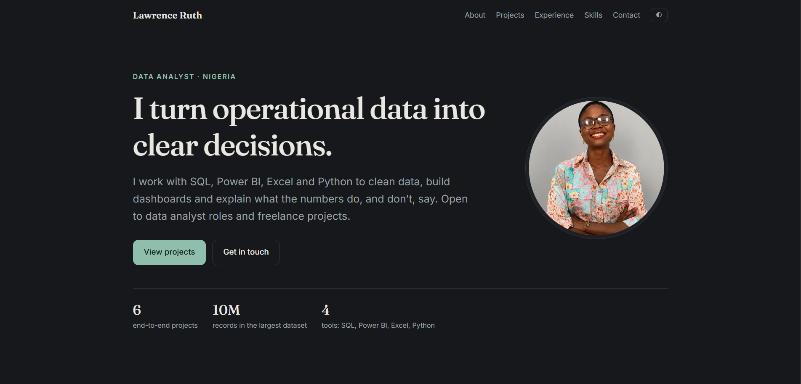

# Lawrence Ruth | Data Analyst Portfolio

A personal portfolio website showcasing my data analytics projects, experience and skills.

**Live site:** [lawrenceruth.github.io](https://lawrenceruth.github.io)

## About

I'm a data analyst who turns operational data into clear decisions, using SQL, Power BI, Excel and Python. I'm open to data analyst roles and freelance work, including dashboards, data cleaning and automated reporting.

## Projects featured

| Project | Tools | Repository | Live |
|---|---|---|---|
| DataCo Global: Sales & Customer Intelligence | Power BI, Power Query, DAX | [Repo](https://github.com/lawrenceruth/DataCo-Global) | [Dashboard](https://app.powerbi.com/view?r=eyJrIjoiZDM0ZDJkMmMtYjQ5Ni00ZDA1LThjZTUtN2ZjNTYwYjNmMGJlIiwidCI6ImI2YTZhZWM2LTc5OTktNDhhYS04YTVlLWYwN2JlMjEzZGJlYyJ9) |
| TacoGo Delivery: Order Decline Diagnostics | Power BI, DAX, Power Automate | [Repo](https://github.com/lawrenceruth/TacoGo-Delivery) | [Dashboard](https://app.powerbi.com/view?r=eyJrIjoiNjQ2ZTZkMGMtMzVlZi00MTYzLThiNGMtYjhmZDM3ZGZiYjIzIiwidCI6ImI2YTZhZWM2LTc5OTktNDhhYS04YTVlLWYwN2JlMjEzZGJlYyJ9) |
| GeoPulse: Store Catchment & Mobility Analytics | SQL, Python, BigQuery, Streamlit, Plotly | [Repo](https://github.com/lawrenceruth/GeoPulse) | [App](https://geopulse-retail-analytics.streamlit.app/) |
| Orion Workforce Analytics: SQL Database Capstone | MySQL, MySQL Workbench, SQL | [Repo](https://github.com/lawrenceruth/Orion-workforce-analytics) | n/a |
| CareFlow: EHR Process Mining | Python, SQL, BigQuery, dbt, Power BI | Coming soon | Coming soon |
| Bank Customer Churn Analysis | Excel, PivotTables | [Repo](https://github.com/lawrenceruth/Customer-Churn-Analysis) | n/a |
| GlowRoot Naturals: Field Activation Dashboard | Excel, PivotTables, COUNTIFS | [Repo](https://github.com/lawrenceruth/Field-Activation-Performance-Analysis) | n/a |

## About the site

- Single-page, responsive layout with automatic light and dark themes
- Built with plain HTML and CSS, with no frameworks or build step
- Dashboard screenshots are embedded in the page, so it loads as one file

## Run it locally

1. Download or clone this repository.
2. Open `index.html` in any web browser.

## Update the site

1. Replace `index.html` in this repository with the new version, keeping the same file name.
2. Commit the change. GitHub Pages republishes within a few minutes.
3. Hard refresh the live site (Ctrl+F5) to see the update.

## Deploy

This site runs on GitHub Pages. To publish your own copy, create a public repository named `<username>.github.io`, upload `index.html`, and open the repository's **Settings → Pages** to confirm it publishes from the main branch.

## Note on the data

These are portfolio projects for learning and demonstration. Several use simulated or sample data, so results should not be read as commercial evidence.

## Contact

- Email: [lawrenceruth34@gmail.com](mailto:lawrenceruth34@gmail.com)
- LinkedIn: [Lawrence Ruth](https://www.linkedin.com/in/ruth-lawrence-8519073b7)
- GitHub: [lawrenceruth](https://github.com/lawrenceruth)
